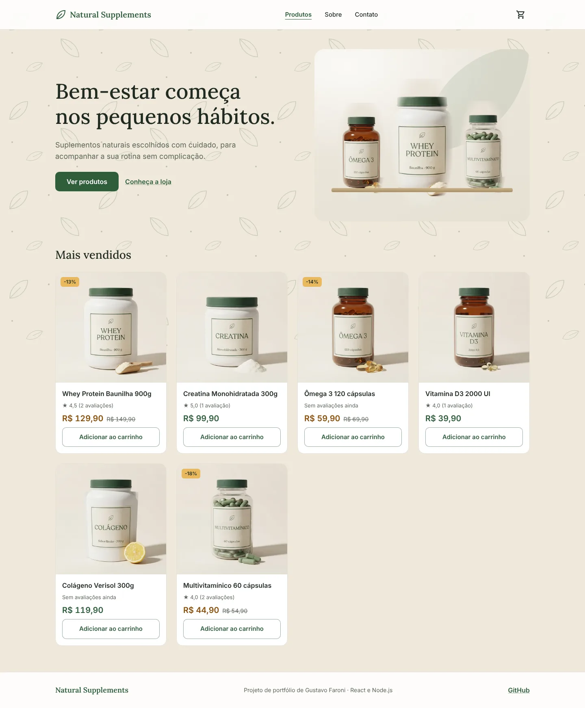
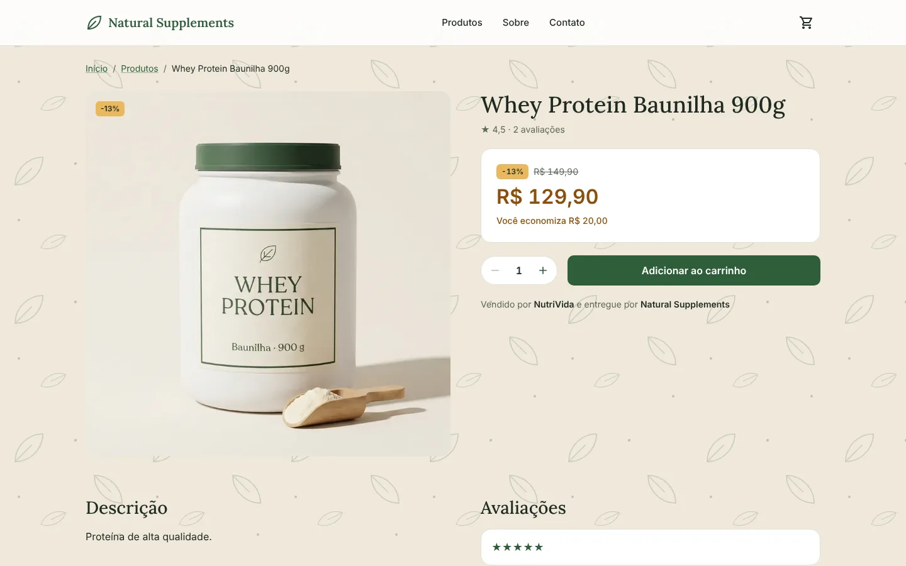
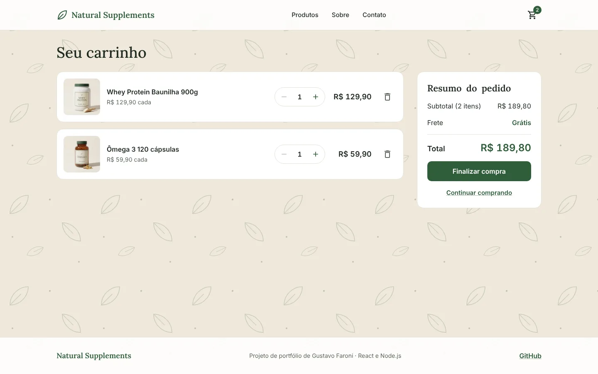
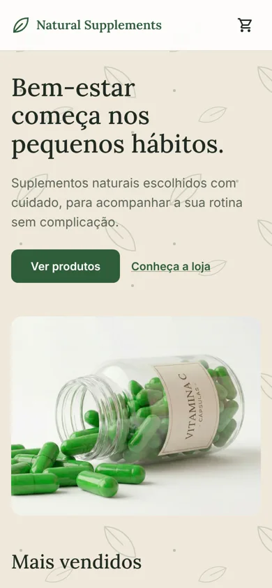

# Natural Supplements

Loja virtual de suplementos naturais feita em **React**, com design system próprio, carrinho persistente e uma **API própria em Node.js** como fonte dos produtos.

**[Ver a loja no ar](https://projeto-final-react-self.vercel.app)** · [Código da API](https://github.com/GustavoFaroni/loja-api)




---

## Sumário

- [Funcionalidades](#funcionalidades)
- [Telas](#telas)
- [Tecnologias](#tecnologias)
- [Arquitetura](#arquitetura)
- [Design system](#design-system)
- [Acessibilidade e desempenho](#acessibilidade-e-desempenho)
- [Como rodar localmente](#como-rodar-localmente)
- [Decisões técnicas](#decisões-técnicas)
- [Próximos passos](#próximos-passos)
- [Autor](#autor)

---

## Funcionalidades

- **Catálogo** carregado da API própria, com selo de desconto, preço promocional e nota média das avaliações.
- **Página de produto** com galeria, seletor de quantidade respeitando o estoque e lista de avaliações.
- **Carrinho** com ajuste de quantidade, remoção com opção de **desfazer**, resumo do pedido e finalização simulada.
- **Carrinho salvo no navegador** (`localStorage`): continua lá depois de recarregar a página.
- **Páginas Sobre e Contato**, com formulário validado campo a campo.
- **Layout responsivo**: 4 colunas no desktop, 3 no tablet e 2 no celular.
- Estados de **carregamento, erro e vazio** em todas as telas que dependem de dados.
- Página **404** para endereços inexistentes.

> É uma loja de demonstração: nenhum pagamento é cobrado e o formulário de contato não envia mensagens.

## Telas

| Produto | Carrinho | Celular |
|---|---|---|
|  |  |  |

## Tecnologias

| Tecnologia | Uso |
|---|---|
| [React 18](https://react.dev) | Interface e componentes |
| [Vite](https://vite.dev) | Servidor de desenvolvimento e build |
| [Material UI 7](https://mui.com) | Componentes, tema e grid |
| [React Router](https://reactrouter.com) | Rotas e navegação |
| Context API | Estado global do carrinho |
| [Axios](https://axios-http.com) | Chamadas à API |
| [Loja API](https://github.com/GustavoFaroni/loja-api) | Back-end próprio em Node.js, Express e MongoDB |
| [Vercel](https://vercel.com) | Publicação |

## Arquitetura

```
src/
├── services/          # comunicação com a API
│   ├── api.js             # instância do axios (endereço base e timeout)
│   └── produtoService.js  # listarProdutos() e buscarProduto(id)
├── hooks/             # lógica reaproveitável
│   ├── useProdutos.js     # useProdutos() e useProduto(id), com cache em memória
│   └── useTituloPagina.js # título da aba por página
├── context/
│   └── CartContext.jsx    # carrinho: itens, totais e ações, salvo no localStorage
├── theme/
│   └── theme.js           # tema do MUI gerado a partir do design system
├── utils/             # funções puras (preço, avaliações, imagens)
├── components/
│   ├── atoms/             # peças pequenas: logo, selo de desconto, seletor de quantidade
│   ├── molecules/         # cabeçalho, rodapé e card de produto
│   └── pages/             # Home, Produto, Carrinho, Sobre, Contato e 404
├── rotas.js           # carregamento sob demanda das páginas
├── App.jsx            # layout e rotas
└── main.jsx           # tema e ponto de entrada
```

Caminho dos dados:

```
API (Vercel) → services → hooks (cache) → páginas → componentes
                                              ↓
                              CartContext ↔ localStorage
```

As páginas nunca chamam o axios direto: pedem os dados a um hook, que usa o service. Se o endereço ou o formato da API mudar, só a camada de services muda.

## Design system

Identidade **natural e calma**, pensada para quem busca bem-estar no dia a dia.

| Token | Cor | Uso |
|---|---|---|
| `herb` | `#2F5D3A` | Cor principal: botões, links e preços |
| `oat` | `#EFE8DA` | Fundo das páginas |
| `sage` | `#DCE5D6` | Fundos de apoio e fotos |
| `honey` | `#E9B95E` | Selo de desconto |
| `ink` | `#1F2A22` | Texto principal |

- **Tipografia:** Lora nos títulos e Figtree no texto.
- **Fundo:** padrão de folhas em linha, com 19% de opacidade.
- **Contraste:** todas as combinações de texto passam do mínimo de 4,5:1 (WCAG AA).
- Os tokens viram o tema do MUI em `src/theme/theme.js`, então os componentes já nascem com o visual da marca.

## Acessibilidade e desempenho

**Acessibilidade**
- Link "Pular para o conteúdo" como primeiro item do teclado.
- Botões de ícone com nome para leitores de tela.
- Campos com rótulo, erro logo abaixo e foco no primeiro campo errado ao enviar.
- Título da aba diferente em cada página.
- Respeita a opção "reduzir movimento" do sistema.

**Desempenho**
- Fotos em WebP com cerca de 15 KB cada (antes, 5 MB).
- Cada página baixa o próprio código (`React.lazy`), e Produto e Carrinho são pré-carregados quando o navegador fica livre. O pacote inicial caiu 18%.
- Lista de produtos guardada em memória: voltar para a Home não chama a API de novo.
- Contexto do carrinho memorizado, para não renderizar componentes à toa.

## Como rodar localmente

Pré-requisito: [Node.js](https://nodejs.org) 20 ou superior.

```bash
# 1. Clone o repositório
git clone https://github.com/GustavoFaroni/projeto-final-react.git
cd projeto-final-react

# 2. Instale as dependências
npm install

# 3. Inicie em modo desenvolvimento
npm run dev
```

A loja abre em `http://localhost:5173` e já usa a API publicada.

Para apontar para outra API (por exemplo, a sua rodando localmente), crie um arquivo `.env` na raiz:

```
VITE_API_URL=http://localhost:3000/api
```

| Comando | O que faz |
|---|---|
| `npm run dev` | Inicia o servidor de desenvolvimento |
| `npm run build` | Gera a versão de produção na pasta `dist` |
| `npm run preview` | Abre a versão de produção localmente |
| `npm run lint` | Verifica o código com o ESLint |

## Decisões técnicas

- **Camada de services:** o endereço da API fica num lugar só. Antes da refatoração, cada página chamava a API por conta própria, e uma delas ainda usava um endereço antigo que já não existia.
- **Hooks com cache em memória:** a lista de produtos é baixada uma vez. Abrir um produto vindo da Home é instantâneo, porque o produto já está na lista.
- **Context API em vez de Redux:** o único estado global é o carrinho. Uma biblioteca de estado seria peso a mais para esse tamanho.
- **Carrinho com chave versionada** (`natural-supplements:carrinho:v1`): se o formato salvo mudar, basta trocar a versão para ignorar dados antigos, em vez de quebrar a página.
- **Fotos servidas pela loja:** a API guarda só o caminho (`/produtos/creatina.webp`). Se uma foto faltar, a loja mostra uma imagem padrão em vez de um ícone quebrado.
- **`vercel.json` com rewrite:** garante que recarregar a página em `/carrinho` ou `/sobre` funcione na Vercel.

## Próximos passos

- [ ] Busca e filtro por categoria, refletidos na URL
- [ ] Login de cliente e histórico de pedidos (a API já tem autenticação JWT)
- [ ] Painel de administração para cadastrar produtos
- [ ] Testes com Vitest e Testing Library

## Autor

**Gustavo Faroni** · Desenvolvedor Front-end Júnior

[LinkedIn](https://www.linkedin.com/in/gustavo-faroni-bentevengo) · [GitHub](https://github.com/GustavoFaroni)
